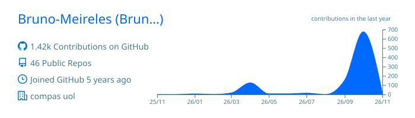
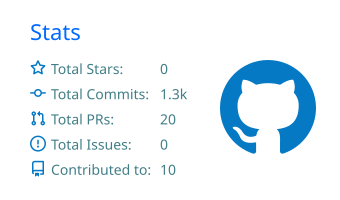
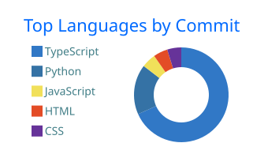

# Bruno Meireles

**Desenvolvedor Full Stack** · React · Next.js · TypeScript · Node.js · Clean Architecture e Testes · Automação com n8n e IA

---

## Sobre mim

Desenvolvo aplicações web rápidas e automações que eliminam trabalho manual. Hoje atuo na **Agência Tupiniquim**, atendendo cerca de 40 clientes em um time de 3 desenvolvedores, do levantamento de requisitos à entrega.

- Elevei notas do PageSpeed de ~40 para 90+ otimizando Core Web Vitals
- Automatizei os backups da agência com n8n, Supabase e SSH: de 1h para 10 min por cliente
- Desenvolvo plugins WordPress, integrações via APIs REST e webhooks, e ferramentas internas para o time
- Uso desenvolvimento assistido por IA no dia a dia, sempre com revisão e testes do código gerado

Antes da tecnologia, fui gerente no varejo liderando equipes de até 15 pessoas.

**Formação:** Pós-graduando em Análise e Projeto de Software (UniAlphaville) · Graduado em Análise e Desenvolvimento de Sistemas (Estácio) e em Desenvolvimento Web (Anhanguera) · AWS Certified Cloud Practitioner

---

## Stack

  

Também trabalho com **n8n** (automações e integrações), **Playwright** (testes E2E), **TanStack Query** e **Clean Architecture**.

---

## Projetos em destaque

### [Mani Meet](https://github.com/Bruno-Meireles/mani-meet-app) · [demo](https://mani-meet-app-three.vercel.app/)
Sistema white-label de agendamento online para salões, com site público e painel administrativo completo.
Reserva atômica no banco (sem horários duplicados), segurança com RLS e Zod, arquitetura em camadas com fronteiras validadas por lint, testes com Vitest e CI no GitHub Actions.
`TanStack Start` `React 19` `TypeScript` `Supabase` `Tailwind CSS` `shadcn/ui`

### [SmartMarket](https://github.com/codetradeai/smartmarket)
Comparador de preços entre 8 redes de supermercado, projeto final em equipe da trilha Dev Full Stack + IA (+praTI). Fui responsável pelos testes automatizados do front-end e do back-end.
`React 19` `Vite` `Spring Boot` `Python` `Docker` `GitHub Actions`

### [Speed Link Diagnose](https://github.com/Bruno-Meireles/speed-link-diagnose)
Ferramenta interna que gera relatórios de performance de sites com dados do PageSpeed Insights.

### [AutoForm](https://github.com/Bruno-Meireles/Bruno-Meireles-Autoform)
Ferramenta que preenche formulários automaticamente durante testes, agilizando o trabalho do time.

---

## Atividade no GitHub

  

  
  

